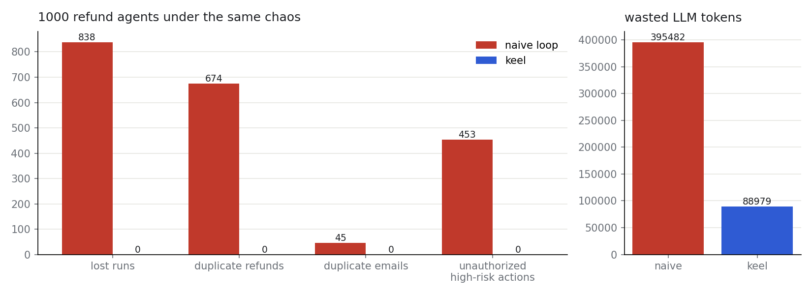
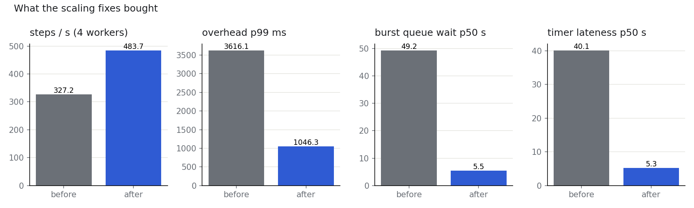
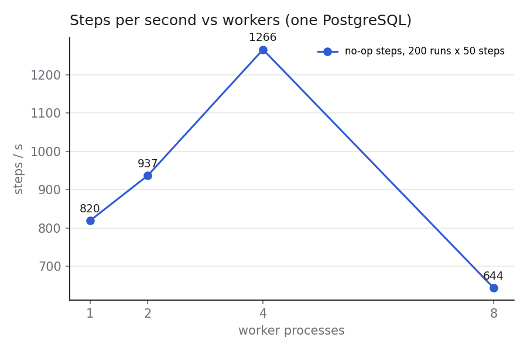
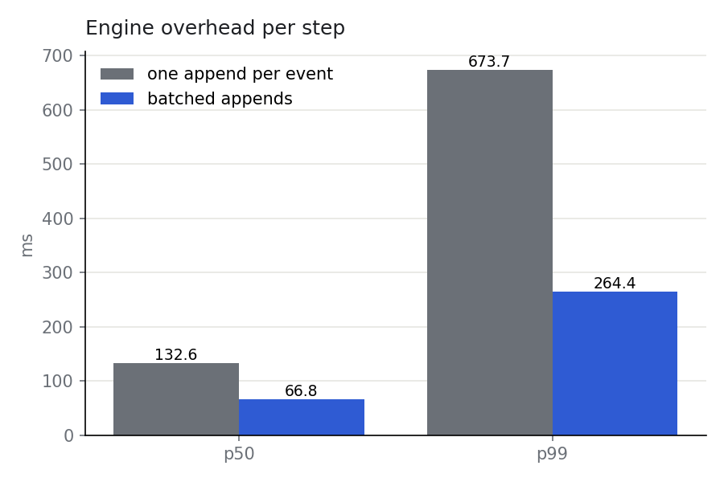
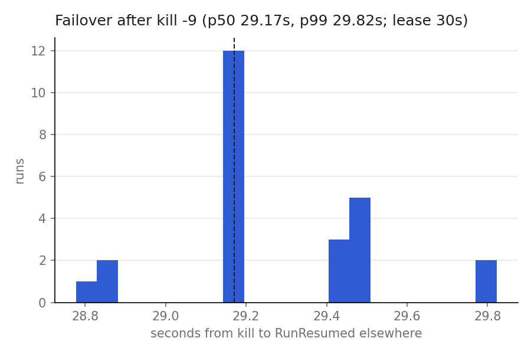
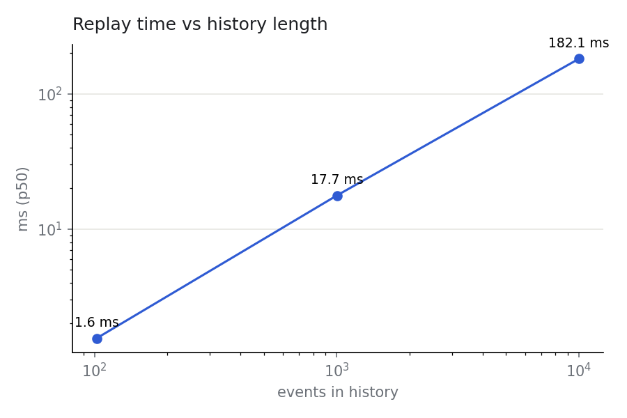
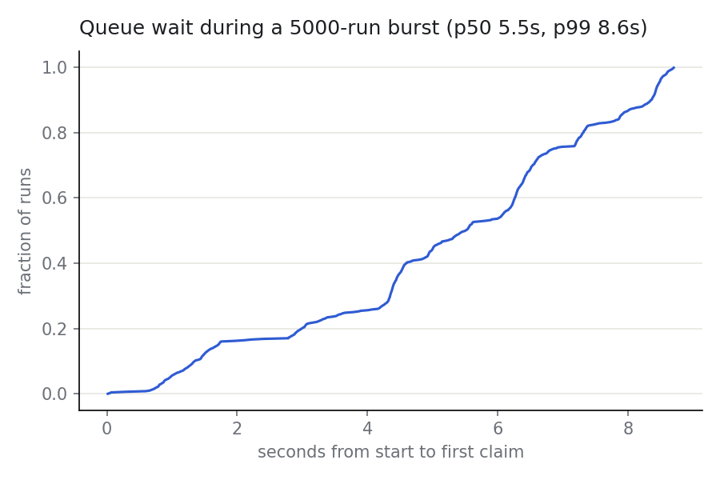
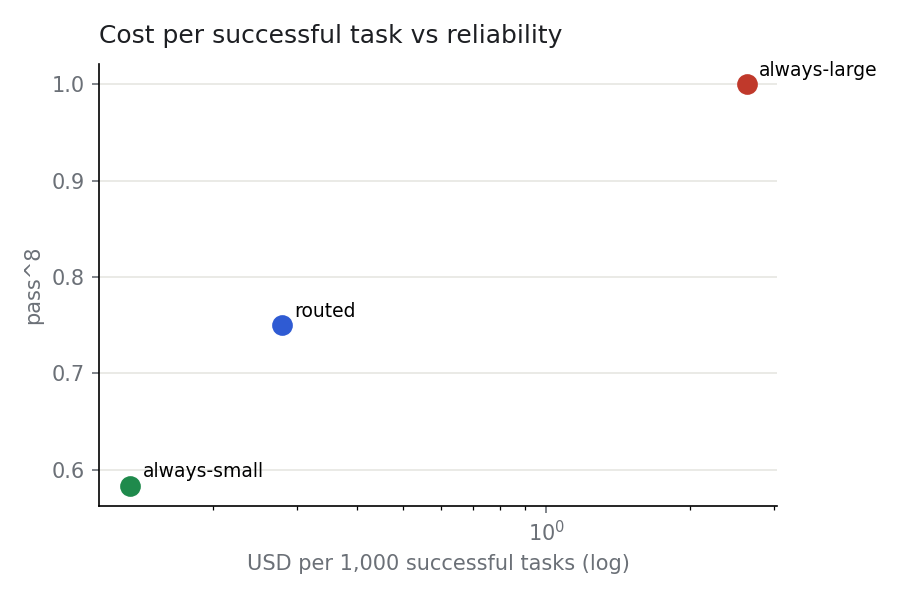
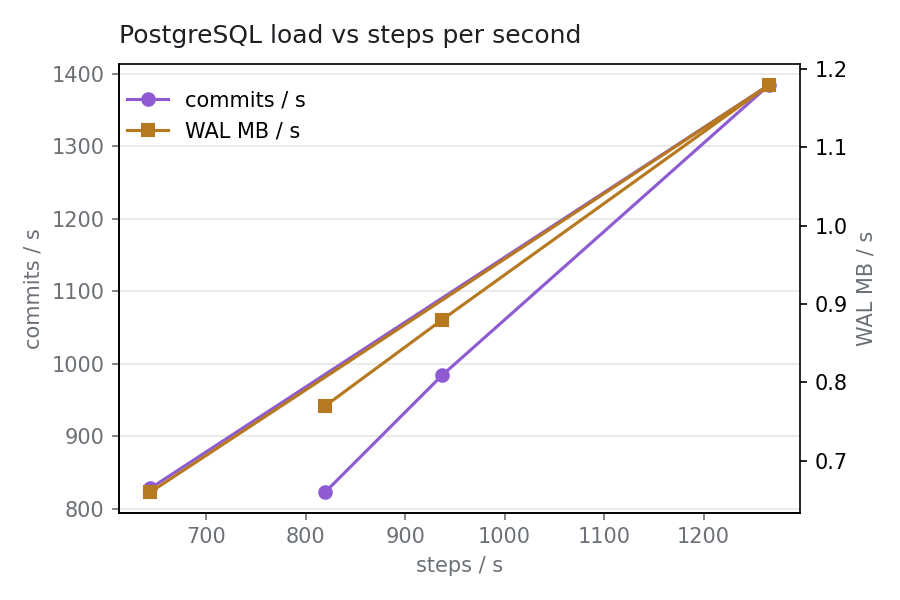

# keel — a durable runtime for AI agents

keel makes AI agents safe to run in production. Runs survive crashes by
replaying an event log, side effects such as refunds happen exactly once,
costs stay within budget, risky actions wait for a human, and every run can be
replayed, inspected and forked. Agents are plain async Python; the control
plane is Go; everything durable lives in PostgreSQL.

**Under chaos** — 1,000 concurrent refund agents, a worker killed every 3
seconds, 10% of LLM calls failing, 20% of payment and email calls failing
*after* committing — keel finished with **0 lost runs, 0 duplicate refunds and
0 duplicate emails** (the naive loop: 838 lost, 674
duplicate refunds, 45 duplicate emails). Engine overhead is
**13 ms per step at p50 and 75 ms at p99** (light load), and routing cuts the cost per
successful task by **92%** versus always using the large model.



> The two-minute screen recording (Grafana with workers dying and runs still
> completing, then the invariant report) is produced by `make chaos-demo` with
> Grafana open at http://localhost:3001 → *keel · engine health*.

## Quick start

```bash
docker compose -f deploy/docker-compose.yml up -d --build
```

One command starts PostgreSQL, two server replicas, the model gateway, the
sandbox, four workers, the mock services and mock LLM, Jaeger, Prometheus,
Grafana and the UI, and seeds the refund demo. UI http://localhost:3000 ·
API http://localhost:8080 · Grafana http://localhost:3001 · Jaeger
http://localhost:16686. (If something on your machine already owns port 8080,
set `KEEL_API_PORT=18080`.)

An agent is a plain async function; every `ctx.` call is journaled:

```python
from keel import workflow, Context, tool

@tool(effect="idempotent", risk="high")          # no effect declaration -> registration fails
async def issue_refund(order_id: str, amount_inr: int, *, key: str) -> dict:
    return await payments.refund(order_id, amount_inr, idempotency_key=key)   # key = run_id:step_id

@workflow(name="support_agent", version="3")
async def support_agent(ctx: Context, ticket: Ticket) -> Outcome:
    messages = [system_prompt(), user_message(ticket)]
    for turn in range(ctx.limits.max_turns):
        reply = await ctx.llm(messages, model="router:support", tools=[issue_refund])
        if not reply.tool_calls:
            return Outcome(answer=reply.text)
        results = await ctx.tools(reply.tool_calls)            # validation, policy, approvals, idempotency
        messages += [reply.message, *tool_result_messages(reply.tool_calls, results)]
    ctx.fail("turn limit reached")
```

Run it with `python -m demos.worker` (or `keel-py worker yourmodule`), start
runs with `keel start support_agent '{"...": "..."}'`, watch them with
`keel events <run_id> --follow`.

## Architecture

```
          clients: apps · keel CLI · replay debugger + approvals UI
                              │ REST
 ┌──────────── control plane ─┴───────────┐   ┌──────────── execution plane ────────────┐
 │ keel-server (Go, stateless replicas)    │   │ workers (Python SDK), 150 runs each     │
 │  REST · gRPC WorkerService ◄────────────┼───┤  poll · replay · append · heartbeat     │
 │  CEL policy · leader-only loops:        │   │        │                     │           │
 │  sweeper · timers · expiry · outbox     │   │  model gateway (Go)      tools · MCP ·   │
 └───────────┬─────────────────────────────┘   │  budgets · routing ·     sandbox         │
             │ one transaction per append       │  rate limits · cache                     │
       ┌─────┴──────┐                           └──────┬────────────────────┬─────────────┘
       │ PostgreSQL │ runs · events · approvals         LLM providers        payments · email · CRM
       └────────────┘ signals · outbox · tenants
```

A run is `pending → running → (waiting ↔ pending) → completed | failed |
cancelled`. A crash or expired lease sends a running run back to `pending`;
the next worker to claim it gets a higher epoch, replays the log and carries
on from the last recorded step. A waiting run (durable sleep, signal, human
approval, child run) holds no worker, so thousands can wait for days at no
cost. Details: [docs/architecture.md](docs/architecture.md).

| Feature | Where |
|---|---|
| Event-sourced run log, fenced appends, blob offload, monthly partitions | `server/internal/store` |
| Deterministic replay, step ids at call time, nondeterminism detection, dev-mode guards, lint | `sdk/python/keel/{replay,executor,determinism,lint}.py` |
| Leases, heartbeats, fencing tokens, fair scheduling, `SKIP LOCKED`, `LISTEN/NOTIFY` | `server/internal/store/runs.go`, `workerapi` |
| Durable timers, buffered signals, cancellation, child runs, continue-as-new, graceful shutdown | store + executor |
| Exactly-once effects: idempotency keys, reconciliation, transactional outbox, sagas | `tools.py`, `executor.py`, `applyDerived` |
| Model gateway: providers, retries + retry budget, circuit breakers, fallbacks, reserve-then-settle budgets, rate limits (memory/Redis), exact + semantic cache, routing + escalation, streaming | `gateway/` |
| Tools: typed registry, validation + repair, MCP, sandbox (warm pool, reaper), secrets, loop detection | `tools.py`, `mcp.py`, `sandbox/` |
| Guardrails: CEL policies, taint tracking, quarantined extraction, durable approvals with edits, PII masking, output checks | `server/internal/policy`, `guard.py` |
| Observability: one trace per run across services, Prometheus metrics, 3 Grafana dashboards, alerts | `deploy/observability` |
| Replay debugger: runs, timeline with crash markers, LLM inspector, diff, fork (dry run), approvals inbox | `ui/` |
| Evals: final-state task suites, pass^k, version reports, CI gate; prompt-injection suite | `evals/` |
| Multi-tenancy: API keys (hashed) with scopes, tenant isolation, caps, budgets, leader election | `server/internal/{auth,api,scheduler}` |
| Deployment: Docker Compose, kind + KEDA, PDBs, graceful rollouts, backups | `deploy/` |

## Guarantees

* **Durability** — once a step's completion is recorded it is never lost and never executed again.
* **At-least-once steps** — a crash between doing a step's work and recording it means the step runs again, with the same idempotency key.
* **Exactly-once effects** for tools that declare `idempotent` or `reconcile`; tools with neither are rejected at registration.
* **Single writer** — every write carries the lease epoch; a stale writer is rejected.
* **Progress** — while one worker and the database are up, every run that is not waiting eventually runs.
* **Not guaranteed** — ordering between runs; exactly-once effects on a service with neither idempotency keys nor lookup (refused instead); a crash during an LLM call costs that call twice (counted, and mostly absorbed by the gateway's idempotency cache).

Threat models for the sandbox and for prompt injection: [docs/guarantees.md](docs/guarantees.md).

## Design decisions

Each with its alternative and the measurement that decided it, in
[docs/design-decisions.md](docs/design-decisions.md): inline steps vs activity
tasks; PostgreSQL as the queue; run-level leases with fencing; acknowledging
retried appends; reserve-then-settle budgets; taint tracking instead of prompt
instructions; CEL; deterministic simulation with a conformance suite; routing
and caching — including **the semantic-cache bug the chaos demo found** (the
first run passed every invariant while 994 of 1,000 emails described another
customer's order).

## Results

Measured on one laptop (8 cores, 7.6 GB for Docker, Windows 11 + Docker
Desktop, PostgreSQL 16, Go 1.26, Python 3.12/3.13), mock LLM for engine
numbers. Raw JSON in `bench/results/`, charts from `python -m bench.plot`.

| Measure | Naive loop | keel |
|---|---|---|
| Lost runs under chaos (of 1,000) | 838 | **0** |
| Duplicate refunds (max per order) | 674 (3) | **0 (1)** |
| Duplicate emails | 45 | **0** |
| Unauthorized high-risk actions | 453 | **0** |
| Wasted LLM tokens | 395,482 of 465,390 (85%) | 88,979 of 821,456 (10.8%)¹ |
| Engine overhead per step, p50 / p99 (10 runs) | — | 13 ms / 75 ms |
| Overhead per step, p99, 100 concurrent runs | — | 264 ms batched, 674 ms unbatched |
| Steps per second (4 workers, batched / unbatched) | — | 1,225 / 601 |
| Failover after kill -9, p50 / p99 (lease 30 s) | — | 29.2 s / 29.8 s |
| Replay time at 100 / 1,000 / 10,000 events | — | 1.6 / 17.7 / 182 ms |
| Queue wait, 5,000-run burst, p50 / p99 | — | 5.5 s / 8.6 s |
| Cost per successful task, routed vs always-large | — | $0.000279 vs $0.002629 (−89%) |

¹ The final run included a ~14-minute stall of the host (every lease expired, and the stall outlasted the gateway's 10-minute idempotency cache). The previous run on the same chaos without the stall wasted 35,225 of 818,925 tokens (4.3%) with 51 kills and 839 crash recoveries.

| Chaos experiment | What must hold | Result |
|---|---|---|
| `chaos.demo`: worker killed every 3 s, 10% LLM errors, 20% fail-after-commit, 1,000 runs | invariants above | PASS (48 kills, 1,605 crash recoveries, 106 approved / 16 rejected) |
| `chaos.zombie`: worker frozen (`docker pause`) 60 s past its 30 s lease | no write accepted from the zombie | PASS: 17 runs held, 0 writes accepted, all 17 finished elsewhere |
| `chaos.leader_failover`: kill the replica holding the advisory lock | loops move, no stuck timer | PASS: takeover in 1.8 s, 100/100 sleepers completed |
| `chaos.db_restart`: restart PostgreSQL under load | no acknowledged event lost | PASS: 150/150 runs, 0 lost events, recovered in 11.4 s |
| Gateway outage test: primary returns 503 | circuit opens, fallback serves, no failure | PASS (`TestOutageOpensCircuitAndFallbackServes`) |
| Budget: 100 parallel calls, budget for ~10 | never overspent | PASS: 10 accepted, 90 rejected |
| Sandbox disk full / memory / fork bomb | fails safely | PASS (12/12 escape tests) |

Scaling (no-op steps, 200 runs × 50 steps): 820 / 937 / 1,266 / 644 steps/s for 1 / 2 / 4 / 8 workers; on this 8-CPU laptop eight workers, the server and PostgreSQL (~1,400 commits/s at the peak) compete for cores. `synchronous_commit=off` changed nothing measurable (491 vs 470 steps/s), so it stays on. Three fixes found by these benchmarks (sharded tenant counters, coalesced NOTIFY, parallel timers) are measured in [docs/design-decisions.md](docs/design-decisions.md#finding-the-bottleneck-three-fixes-measured-before-and-after).

Evals (refund_core, 12 tasks × 8 trials, fixed seeds): pass^8 v1 0.667, v2 0.750, v3 (deliberately worse) 0.333 — CI blocks v3. Injection suite (60 attacks, 60 legitimate): 0% attack success for both versions; false escalation 58.3% (v1) vs 1.7% (v2). Sandbox start: warm p50 1.5 s vs cold 2.4 s (Docker Desktop/WSL2).











## Testing

| Test | What it proves | Result |
|---|---|---|
| Deterministic simulation (`sim/`) | Invariants hold under seeded fault schedules; any failure replays from its seed | 1,000 full seeds + 200 CI-size seeds, 0 failures (16,625 mid-call crashes, 37,356 freezes past the lease, 17,679 outages, 7,777 dropped responses) |
| Conformance (`tests/conformance`) | The Go server and the simulation's server behave identically; Go and Python CEL agree | 5 scenarios × 2 backends pass |
| Replay property test | Random workflows crashed before and after every write reach the same result, effects once | 25 hypothesis programs × every crash point |
| `run_with_crashes` on the refund agent | Same with 30% fail-after-commit | 58 crash points, 1 refund + 1 email each |
| Nondeterminism detection | `time.time()`, `random`, set iteration (replayed under another hash seed), reordered steps, changed input | all 5 caught |
| Fencing (`TestFencingConcurrentAppenders`) | Stale epochs never write; sequences contiguous | 1,000 rounds, 0 stale writes |
| Go race detector | No data races in store, scheduler, policy | `go test -race` (Linux container / CI) |
| API contract (`tests/api`) | Status codes, scopes, cross-tenant isolation, 429 + Retry-After, PII reveal permission | 9 tests pass |
| Sandbox escapes | Network, DNS, fork bomb, writes outside /tmp, env secrets, disk fill, memory, setuid, Docker socket, infinite loop, output flood | 12 / 12 blocked |
| Prompt injection (`evals/injection_suite.py`) | No attack executes a high-risk action without approval | 60 attacks + 60 legit: 0% attack success |
| Evals + CI gate | pass^k per version; a worse version is blocked | v3 blocked (pass^4 0.39 < 0.60) |
| Fuzzing | Policy expressions, PII masking, event payload decoding never crash | `go test -fuzz`, 60 s per target in CI |
| Chaos (`chaos/`) | Invariants on the real deployment | see Results |

## Limitations and next steps

* One PostgreSQL instance: throughput stops growing where commits per second
  saturate (see the scaling chart). Next: group appends from many workers
  into one transaction, PgBouncer, then shard the event log by run id.
* The semantic cache's built-in hashed n-gram embedding separates paraphrases
  from near-misses poorly; useful hit rates need a real embedding model.
* The sandbox shares the host kernel unless run with gVisor (`runsc`); the
  sandbox service needs the Docker socket (run it rootless or on its own VM).
* Routing escalates on malformed output only, not on wrong decisions;
  routed and always-small have the same pass^k on the refund suite. A learned
  router trained on eval results is the obvious next step.
* Numbers come from a laptop with Docker Desktop; absolute latencies
  (especially sandbox start-up, 1.5 s warm on WSL2) are much lower on Linux.
* Not built: multi-region, a polished product UI, a TypeScript SDK.

## Repository layout

```
proto/keel/v1/worker.proto   gRPC worker protocol
server/                      Go: store, workerapi, api, scheduler, policy, auth, pii, blob, metrics; cmd/keel-server, cmd/keel (CLI)
gateway/                     Go model gateway: providers, breaker, budget, ratelimit, cache, router
sandbox/                     Go code sandbox + escape tests
sdk/python/keel/             Python SDK (workflow, replay, executor, worker, tools, mcp, guard, policy, testing)
demos/                       refund agent, research agent, analysis agent, mock services + mock LLM, MCP server
sim/  chaos/  bench/  evals/ simulation, chaos experiments, benchmarks, evals
ui/                          React replay debugger and approvals inbox
deploy/                      docker-compose, k8s (kind + KEDA), observability, policy.yaml, gateway.yaml
tests/                       conformance and API contract suites
```
